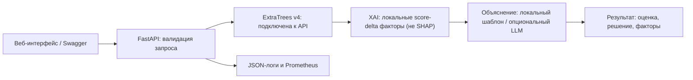

# Актуальное состояние разработки — 21 ноября 2026

Этот раздел фиксирует **реализовано / проверено / не подтверждено**, а не обещания о готовности production.

| Компонент | Реализовано в main | Подтверждение и ограничения |
|---|---|---|
| ExtraTrees v4 | Загрузка сохранённой модели, feature engineering, score и порог review | Запущенный Codespaces сообщает версию v4 через model-info; свежий полный e2e после последних изменений не подтверждён |
| XAI | Только TreeSHAP через shap.TreeExplainer; группировка one-hot и связанных производных признаков | Сервер проверяет base + все SHAP = predict_proba; интерфейс показывает топ-5 + остальные. Никакого score-delta для v4 |
| API | /v1/score отдаёт shap_base_value, shap_all_factors, shap_other_value, top_factors | Старый процесс FastAPI после git pull может продолжать возвращать прежнюю схему: перезапуск сервера необходим для загрузки нового Python-кода |
| Интерфейс | Валидация SHAP-ответа и аддитивности; диагностическое сообщение вместо ошибки undefined.toFixed | Реальная проверка в браузере после перезапуска сервера ещё не подтверждена |
| GroqCloud | Выбор провайдера по умолчанию groq; запрос генерации текста по проверенным SHAP-факторам | Требуются ANTIFRAUD_LLM_ENABLED=1, GROQ_API_KEY и GROQ_MODEL в среде запуска. Если они отсутствуют, используется локальный шаблон; доступность внешнего API не подтверждена |
| LLM-валидация | Проверка JSON, разрешённых факторов и запрет неподтверждённых чисел | Это ограниченная проверка, а не формальная гарантия отсутствия всех галлюцинаций |
| AI-агент ReAct | Проект архитектуры и инструментов | Автономный агент с вызовами инструментов **не реализован** |
| Данные | Синтетический учебный набор v3 | Score не является калиброванной банковской вероятностью мошенничества |
| Тесты | Есть unit и e2e-тесты TreeSHAP | Успешный запуск CI для текущего коммита ещё не подтверждён |

## Проверка в Codespaces после git pull

1. Обновить `main` через `git pull origin main`.
2. **Перезапустить уже работающий процесс FastAPI** (обычный git pull не загружает новый Python-код в процесс).
3. Открыть `GET /v1/model-info`: ожидать `model_version=extratrees-engineered-v4`, `shap_api_contract=tree_shap_v2`; поля `llm_enabled`, `llm_provider`, `llm_credentials_configured`, `llm_model_configured` показывают готовность настройки без раскрытия секретов.
4. Отправить демонстрационную операцию через интерфейс. Проверить `shap_base_value + sum(shap_all_factors.shap_value) ≈ risk_score` (допуск на округление до 0.00015), пять крупнейших факторов и остаток.
5. Для реального GroqCloud проверить `explanation_method=groq_grounded_generation`. Значение `shap_template_*` означает, что использован локальный fallback. Ключи не записывать в Git и не публиковать.

**Важно:** работающий /v1/model-info и версия модели v4 сами по себе не доказывают, что запущенный процесс использует обновлённую схему /v1/score. Это было причиной неоднозначности при диагностике ошибки SHAP в браузере.

---
## Актуальный контракт TreeSHAP и GroqCloud (21.11.2026)

Для ExtraTrees v4 применяется **только TreeSHAP** на сохранённой модели после исходного преобразования и масштабирования признаков. Сервер проверяет равенство `shap_base_value + sum(shap_all_factors[].shap_value) = risk_score` с допуском 1e-5 до округления. `top_factors` содержит пять крупнейших смысловых групп; `shap_other_value` — сумму остальных. Интерфейс отображает пять факторов и «Остальные», проверяет восстановление прогноза и не вызывает `toFixed` для отсутствующих значений. SHAP-вклады выражены в единицах прогноза модели, а не в причинном влиянии или банковской вероятности мошенничества.

При включённом LLM и настроенном GroqCloud сервис запрашивает **генерацию текста** по проверенным SHAP-факторам в ограниченной JSON-схеме. Ответ проверяется по списку допустимых факторов; при сетевой ошибке, отсутствии ключа или некорректном ответе используется детерминированный fallback. Успешный реальный запрос к GroqCloud требует отдельной проверки в Codespaces с пользовательским ключом; CI не подтверждает доступность внешнего провайдера.

Исторические упоминания score-delta в нижеследующих разделах относятся к прежнему интерфейсу и не описывают актуальный код; при подготовке итоговой защиты использовать именно этот контракт. Изменения внесены в ветку `fix/shap-ui-llm-docs-20261121`; до слияния с `main` они не считаются опубликованным релизом.

> **Обновление XAI (21.11.2026).** Для финальной ExtraTrees v4 реализован TreeSHAP с проверкой аддитивности: базовое значение + сумма SHAP-вкладов = прогноз класса мошенничества. В интерфейсе связанные закодированные и производные признаки суммируются по смысловым группам. В GroqCloud передаются только проверенные названия и вклады SHAP, без персональных данных. Модель и её порог не переобучались. Новый CI-прогон требуется для подтверждения внедрения; старые результаты score-delta относятся к предыдущей версии интерфейса.


# Antifraud AI — обнаружение подозрительных банковских транзакций с XAI и LLM

**Учебный командный ML/MLOps-проект · вебинары 1–16 · Python · ExtraTrees v4 · XAI · FastAPI · GroqCloud**

В рамках проекта нами разработан прототип интеллектуальной системы анализа банковских транзакций. Сервис принимает параметры операции, рассчитывает оценку риска с помощью обученной модели машинного обучения, показывает влияющие на результат факторы и формирует объяснение для аналитика. Для демонстрации создан веб-интерфейс с интерактивной формой, примерами операций, визуализацией диагностических факторов ExtraTrees v4 (score-delta, не SHAP) и доступом к техническому API.

> **Область применения:** образовательная демонстрация полного цикла разработки ML-сервиса. Обучающие данные синтетические, оценка риска не откалибрована как банковская вероятность мошенничества; система не подключена к реальным платёжным операциям и не блокирует их автоматически.

## Зафиксированный выбор модели — ExtraTrees v4

**Модель для защиты:** `ExtraTreesClassifier(n_estimators=200, max_depth=4, min_samples_leaf=6, random_state=42)`, 13 исходных + 7 производных признаков. Архив [extratrees-v4-artifact.zip](extratrees-v4-artifact.zip) уже в `main`. Validation PR-AUC **0,342852**, ROC-AUC **0,803479**; 5 000 train / 1 000 validation / 1 000 test, синтетические данные. Сравнение охватывало **16 семейств × 2 набора признаков = 32 конфигурации**, с неодинаковым бюджетом Optuna (3–8 trials). Победитель выбран по validation PR-AUC, не по test. Последующий отдельный поиск ExtraTrees (30+30 trials, 50–100 деревьев) дал **0,312462** для engineered и **не включал** победившие 200 деревьев. Поэтому выбранная конфигурация — лучший *наблюдавшийся* кандидат, а не доказанный глобальный оптимум. Порог для v4 **не откалиброван как банковская вероятность** и выбран на validation с ограничением FPR ≤ 10%. В локальной независимой проверке v4 получены test PR-AUC **0,237103** и ROC-AUC **0,697491**; эти результаты не подтверждают применимость к реальным банковским данным. [Все 32 строки](docs/WEBINAR05_32_EXPERIMENTS.md) · [CSV](experiments/benchmark_16_results.csv) · [дополнительный прогон](experiments/deep_extratrees_results.json).

**Статус системы:** архив опубликован; `src/antifraud/app.py` и `scripts/start_codespaces.py` подключают ExtraTrees v4. Интерфейс запускался пользователем в Codespaces и показывал ответ `extratrees-engineered-v4`; автоматизированные проверки v4 и API подтверждены в GitHub Actions; проверка браузера и production-развёртывания остаётся отдельной задачей. Старые результаты CatBoost/Blend ниже — исторические этапы, не текущий выбор.

## Актуальная конфигурация для защиты — ноябрь 2026

**Мы как команда** подготовили учебный антифрод-сервис на основе **ExtraTrees v4**, а не ансамбля CatBoost + LightGBM. Исторические результаты CatBoost, LightGBM, RandomForest и Blend приведены ниже только для демонстрации исследовательского процесса. Финальная модель: 200 деревьев, глубина 4, минимум 6 объектов в листе; 13 исходных и 7 производных признаков.

**Доказанные результаты:** validation PR-AUC **0,342852**; test PR-AUC **0,237103**, test ROC-AUC **0,697491**. Синтетический датасет v3: 7 000 транзакций (5 000 / 1 000 / 1 000). Сравнили 32 конфигурации. В GitHub Actions успешно завершился [отдельный прогон финальной модели](https://github.com/SamDerden/Fraud_Detection_with-XAI_and_LLM/actions/runs/44890730210): шесть тестов вебинара 7, три API-демосценария и два E2E-теста. Это **не** подтверждает качество на реальных банковских данных и не заменяет ручную проверку браузера.

**Реализованная цепочка:** HTML-форма → Pydantic/FastAPI → ExtraTrees v4 → пять диагностических score-delta факторов → локальное или опциональное GroqCloud-пояснение. Score-delta — не SHAP. Автономный AI-агент из вебинара 14 спроектирован, но не реализован как самостоятельный исполнитель инструментов.

**Что ещё не завершено:** эксперимент удаления признаков устройства подготовлен, но его результаты пока не получены; для запуска нужен исходный CSV v3. В новом Codespaces подтверждены запуск v4 и открытие сайта. Ключ GroqCloud обнаружен, но конкретный внешний запрос завершился fallback; проверяется причина (тайм-аут или ошибка ответа). Отчёт и презентация готовятся отдельно.

## 1. Цель, задача и результат

**Проблема.** Большой поток операций затрудняет своевременное выявление подозрительной активности. Помимо оценки риска, специалисту необходимо понимать, какие признаки повлияли на вывод алгоритма.

**Цель проекта** — спроектировать и реализовать объяснимый ML-сервис, способный оценивать транзакции и помогать оператору принимать решение о необходимости дополнительной проверки.

**Результаты разработки:**

- Подготовлен и исследован учебный датасет v3; выполнены проверки качества и анализ ограничений.
- Проведён расширенный скрининг **16 семейств алгоритмов × 2 набора признаков = 32 конфигурации** с Optuna, а также отдельный углублённый прогон ExtraTrees (60 попыток).
- **Выбрана и сохранена ExtraTrees v4** (13 исходных + 7 новых признаков, validation PR-AUC 0,342852); архив `extratrees-v4-artifact.zip` загружен в `main`. **API подключён к v4; автоматические тесты v4 успешно выполнены в GitHub Actions**.
- Реализован скоринг через **FastAPI**, включая валидацию входных признаков и структурированный ответ.
- В существующем API реализованы объяснения CatBoost/ансамбля; **для ExtraTrees v4 реализованы локальные score-delta факторы (не SHAP); API E2E-тест пройден в GitHub Actions**.
- Добавлен опциональный **LLM-слой** с поддержкой GroqCloud, Grok и OpenRouter и безопасным локальным резервным объяснением.
- Создан адаптивный веб-интерфейс с формой, примерами сценариев, результатом оценки, SHAP-графиками и разделом метрик.
- Подготовлены тесты, GitHub Actions CI, Docker-конфигурация, Prometheus-метрики, JSON-логи, документация развёртывания и стратегия мониторинга.

## 2. Архитектура решения



| Компонент | Назначение | Реализация |
|---|---|---|
| Данные и исследование | Подготовка признаков, проверка качества, сравнение моделей | Python, pandas, scikit-learn, CatBoost, LightGBM |
| ML-ядро | Скоринг по 13 входным и 7 производным признакам | ExtraTrees v4 подключена в серверном коде |
| Объяснимость | Выявление факторов, повышающих и снижающих оценку риска | Для legacy CatBoost — SHAP; для ExtraTrees v4 — score-delta диагностика |
| LLM-слой | Дополнительное текстовое объяснение на основе рассчитанных факторов | GroqCloud / Grok / OpenRouter, опционально |
| API | Приём транзакции, валидация, скоринг, ответы | FastAPI, Pydantic |
| Пользовательский интерфейс | Ввод транзакции и визуализация ответа | HTML, CSS, JavaScript |
| Контроль качества и эксплуатация | Тесты, CI, логи, метрики, контейнеризация | pytest, GitHub Actions, Prometheus, Docker |

**Принцип объяснимости:** LLM не определяет факт мошенничества, не меняет оценку модели и не придумывает новые причины. Источником факторов служит модельная диагностика (score-delta для v4, SHAP только для исторических CatBoost-экспериментов). При недоступности LLM используется детерминированное объяснение. Единицы вкладов зависят от конкретного XAI-метода и модели; нельзя переносить log-odds SHAP CatBoost на ExtraTrees без новой проверки.

## 3. Данные и модель

Для исследования использован синтетический датасет **v3 из 7 000 размеченных транзакций**, относящихся к 220 пользователям. В нём 321 операция с положительной меткой (4,59%). Дополнительная история из 3 776 событий использовалась для расчёта признаков и не включалась в размеченные 7 000 операций.

| Выборка | Число операций | Назначение |
|---|---:|---|
| Train | 5 000 | Обучение |
| Validation | 1 000 | Сравнение моделей и выбор порога |
| Test | 1 000 | Независимая итоговая оценка |
| **Всего** | **7 000** | Хронологическое разбиение |

Исходные данные содержат 13 входных признаков; выбранная ExtraTrees v4 дополнительно вычисляет 7 производных признаков (20 до one-hot кодирования), включая сумму, час и день операции, среднюю сумму за 30 дней, частоту операций, разнообразие мерчантов и стран, возраст устройства, признаки нового устройства и ночной операции, канал и страну. Идентификаторы, метка `is_fraud` и столбец `split` не используются как предикторы.

### Результаты сравнительного эксперимента v3

| Алгоритм | PR-AUC, validation | PR-AUC, test |
|---|---:|---:|
| RandomForest | 0.25328 | 0.22334 |
| CatBoost | 0.24352 | 0.21451 |
| LightGBM | 0.20174 | **0.25524** |
| CatBoost + LightGBM (blend) | **0.25779** | 0.22161 |

**Интерпретация:** ансамбль показал лучший PR-AUC на валидации, а LightGBM — на тесте. **В том раннем четырёхмодельном эксперименте лучшим был ансамбль (0,25779), но в последующем расширенном сравнении 32 конфигураций победила ExtraTrees v4 (0,342852).** Вес CatBoost 0,9 выбран на validation. На независимом test PR-AUC ансамбля составляет 0,22161; LightGBM достигает 0,25524, однако выбирать модель задним числом по test методологически неверно. Порог направления на ручную проверку выбирался на validation, а не на test.

В анализе данных выявлена сильная связь признака нового устройства с синтетической меткой мошенничества; это ограничение генератора и риск переноса модели на реальные данные. Обобщение на новых клиентов и реальные банковские операции не подтверждено.

Подробности: [сравнение моделей](docs/V3_BENCHMARK.md), [эксперименты](docs/05_experiments_mlflow.md), [тестирование](docs/07_model_testing.md).

## 4. Пользовательский сценарий и интерфейс

Веб-интерфейс позволяет описать операцию: указать сумму, канал, страну, средний чек, количество операций за 24 часа и 7 дней, число уникальных мерчантов и стран, возраст устройства и время транзакции. Признаки нового устройства и ночной операции рассчитываются автоматически.

После нажатия **«Проверить транзакцию»** браузер вызывает `POST /v1/score`. На экране отображаются:

1. Оценка риска модели и решение **«Одобрить» / «На ручную проверку»**.
2. Пять локальных диагностических score-delta факторов с направлением изменения оценки (это не SHAP).
3. Текстовое объяснение с указанием фактически использованного метода: локальный шаблон или опциональный LLM, если настроен.
4. Версия модели и сведения об учебном характере данных.

В интерфейсе предусмотрены три примера — обычная, подозрительная и ночная операция. Они **заполняют форму**, но не подменяют результат заранее заданным ответом. Дополнительно доступны разделы «Команда и разработка», «О проекте» (16 вебинаров), «О модели», «Метрики и результаты», «Данные и эксплуатация», «Интеллект и безопасность», «Анализ транзакции» и «API (Swagger)».

**Важное ограничение:** выводимая оценка — некалиброванный скор модели. Даже высокий риск означает рекомендацию ручной проверки, а не доказанное мошенничество и не автоматическую блокировку.

## 5. Реализация практик вебинаров 1–16

Ниже приведён результат работы по каждому занятию и соответствующие материалы проекта. Наличие скрипта или проектного решения отдельно от его фактического запуска отмечено явно.

| Вебинар | Тема и выполненная работа | Материалы |
|---|---|---|
| **01** | **Жизненный цикл AI-продукта.** Определены бизнес-проблема, заинтересованные стороны, этапы ML-разработки, метрики и основные риски. | [01_lifecycle.md](docs/01_lifecycle.md) |
| **02** | **Архитектура.** Спроектирован путь транзакции от входного интерфейса через API и ML-модель к объяснению и мониторингу; описаны компоненты и связи. | [02_architecture.md](docs/02_architecture.md) |
| **03** | **Контракт ML-сервиса.** Определены входные поля, правила валидации, выходной формат, ошибки и ограничения API. | [03_contract.md](docs/03_contract.md) |
| **04** | **MLOps-зрелость.** Проведена оценка процессов и подготовлена дорожная карта развития: воспроизводимость, CI/CD, мониторинг и управление моделями. | [04_mlops_profile.md](docs/04_mlops_profile.md) |
| **05** | **MLflow и эксперименты.** Подготовлен сценарий трекинга экспериментов v3 и сравнения запусков; выполнение полного MLflow-прогона в целевой среде не подтверждено. | [05_experiments_mlflow.md](docs/05_experiments_mlflow.md), [webinar05_mlflow_v3.py](experiments/webinar05_mlflow_v3.py) |
| **06** | **Качество данных.** Исследован отдельный исходный проблемный датасет, зафиксированы нарушения согласованности истории; реализован валидатор на pandas. Great Expectations не запускался. | [06_data_validation.md](docs/06_data_validation.md), [webinar06_validate_legacy.py](experiments/webinar06_validate_legacy.py) |
| **07** | **Тестирование ML.** Помимо ранних тестов RandomForest на данных v3, добавлены шесть проверок финального артефакта ExtraTrees v4: скоринг, метаданные и параметры, повторяемость, признаки, негативный контракт и ответ API. Отдельный workflow GitHub Actions прошёл успешно. | [07_model_testing.md](docs/07_model_testing.md), [test_webinar07_extratrees_v4.py](tests/test_webinar07_extratrees_v4.py), [CI v4](.github/workflows/extratrees-v4.yml) |
| **08** | **Стратегия тестирования.** Подготовлены unit-, integration- и mock-тесты для компонентов сервиса и негативных сценариев. | [08_testing_strategy.md](docs/08_testing_strategy.md), [test_webinar08_components.py](tests/test_webinar08_components.py) |
| **09** | **API для ML.** Реализован FastAPI со скорингом, сведениями о модели, healthcheck и Swagger; добавлен веб-интерфейс. Автоматический E2E-тест API с реальной ExtraTrees v4 пройден; проверка интерфейса в браузере проводится отдельно. | [09_api_for_ML.md](docs/09_api_for_ML.md), [app.py](src/antifraud/app.py) |
| **10** | **Стратегия развёртывания.** Спроектированы варианты выпуска, shadow/canary, контроль метрик и rollback. Промышленное canary-развёртывание не проводилось. | [10_deploy_strategy.md](docs/10_deploy_strategy.md) |
| **11** | **Контейнеризация и деплой.** Подготовлены Dockerfile, Docker Compose и конфигурация GitHub Codespaces с автозапуском учебной модели. | [11, 12_deploy_and_support.md](docs/11%2C%2012_deploy_and_support.md), [Dockerfile](Dockerfile), [devcontainer.json](.devcontainer/devcontainer.json) |
| **12** | **Наблюдаемость.** Реализованы структурированные JSON-логи и endpoint `/metrics` для Prometheus; определены эксплуатационные метрики и сигналы. Полноценная внешняя система алертинга не развёрнута. | [11, 12_deploy_and_support.md](docs/11%2C%2012_deploy_and_support.md), [observability.py](src/antifraud/observability.py) |
| **13** | **Data drift.** Выполнены расчёты KS/PSI на train и validation v3, выявлен выраженный сдвиг `device_age_days`; описаны пороги, реакция и стратегия переобучения. Онлайн-мониторинг дрейфа не запущен. | [13_drift_strategy.md](docs/13_drift_strategy.md), [webinar13_drift_v3.py](experiments/webinar13_drift_v3.py) |
| **14** | **Проектирование AI-агента.** Описан ассистент аналитика антифрода: цель, четыре инструмента, источники, метрики, риски и схема ReAct с двумя итерациями. По заданию разработан проект агента, не исполняемый агент. | [14_AI_agent.md](docs/14_AI_agent.md) |
| **15** | **Промпт-инжиниринг.** Разобран процесс уточнения задачи с AI-ассистентом, реализован поиск пар чисел и pytest-тесты; формулировки промптов восстановлены, не представлены как дословный журнал переписки. | [15_prompt_engineering.md](docs/15_prompt_engineering.md), [webinar15_pairs.py](experiments/webinar15_pairs.py) |
| **16** | **Ответственный AI и code review.** Проведён аудит безопасности, обработки PII, секретов, галлюцинаций LLM, смещений и ограничений эксплуатации; сформулированы критерии приёмки. Отзыв ранее раскрытого ngrok-токена владельцем ещё не подтверждён. | [16_vibe_coding.md](docs/16_vibe_coding.md) |

Общий реестр выполнения: [PRACTICE_COVERAGE.md](docs/PRACTICE_COVERAGE.md). Итоговый аудит: [FINAL_AUDIT_01_16.md](docs/FINAL_AUDIT_01_16.md). Формальная сдача отдельных материалов преподавателю в сторонних системах не подтверждена и не приравнивается к наличию файлов в репозитории.

## 6. Проверки, безопасность и ограничения

**Реализованные меры:** проверка Pydantic-схемы и согласованности вычисленных признаков, ограничение внешних LLM-провайдеров известными адресами, передача только обезличенных диагностических факторов, отказ от автоматической блокировки, детерминированный fallback объяснения, тесты, CI, логи и метрики.

**Ограничения текущего прототипа:**

- Синтетические данные не подтверждают качество на реальном банковском потоке; вероятность модели не калибрована.
- Полный E2E последнего веб-интерфейса, включая живой ответ GroqCloud, требует отдельной проверки в запущенном Codespaces.
- MLflow v3, Great Expectations, внешние алерты и промышленное развёртывание не заявляются как завершённые.
- **Для защиты выбрана ExtraTrees v4** по лучшему validation PR-AUC среди 32 конфигураций. Она приоритетно загружается в Codespaces; legacy-модели оставлены для обратной совместимости. Автоматический API E2E успешно выполнен в GitHub Actions, браузерный запуск требует отдельной проверки.
- Ранее раскрытый ngrok-токен должен быть отозван владельцем; наличие обновлённого кода не устраняет секрет из истории Git.

## 7. Структура репозитория

```text
Fraud_Detection_with-XAI_and_LLM/
├── .devcontainer/                  # Настройки Codespaces
├── extratrees-v4-artifact.zip      # Финальная модель v4, подключённая к API
├── catboost-v3-artifact.zip        # Ранее опубликованная модель v3
├── blend-v3-artifact.zip           # Ансамбль v3 после публикации
├── src/antifraud/
│   ├── app.py                      # FastAPI и маршруты
│   ├── dashboard.html              # Веб-интерфейс
│   ├── model_artifact.py           # Загрузка и проверка CatBoost
│   ├── explain.py                  # SHAP-объяснение
│   ├── llm.py                      # Опциональный LLM-слой
│   └── observability.py            # Логи и метрики
├── experiments/                    # Обучение, сравнение, аудит, практики
├── tests/                          # Автоматические проверки
├── scripts/
│   ├── start_codespaces.py         # Подготовка модели и запуск API
│   └── autostart_codespaces.sh     # Автозапуск среды
├── docs/                           # Практики вебинаров 1–16 и аудит
├── Dockerfile
├── docker-compose.yml
├── requirements.txt
└── README.md
```

В текущем дереве публичной ветки `main` не обнаружен исходный CSV v3 с 7 000 транзакций. Это не означает утраты файла в Colab или других хранилищах: для запуска сервиса нужен сохранённый модельный артефакт, а для переобучения — исходные данные. Секреты и реальные банковские данные в Git не добавляются.

---

### Исторический кандидат: ансамбль v3 (заменён выбором ExtraTrees v4)

В раннем сравнении четырёх кандидатов был выбран ансамбль **0,9 × CatBoost + 0,1 × LightGBM**. **Это исторический этап; текущий выбранный кандидат — ExtraTrees v4.** Обе модели обучены только на train (5 000 строк), вес выбран по validation (1 000), test (1 000) использован лишь для независимой оценки. Validation PR-AUC = **0,25779**, test PR-AUC = **0,22161**; recall на test = **25/59 = 42,37%**, FPR = **97/941 = 10,31%** при validation-пороге **0,04966596418**. Отдельный LightGBM имеет более высокий test PR-AUC, но выбирать его по test было бы утечкой при выборе модели.

Подготовлен экспортированный архив `blend-v3-artifact.zip` с `catboost.cbm`, `lightgbm.joblib` и `metadata.json`. **Ансамбль сохранён как исторический эксперимент, не как финальный выбор.** При наличии архива ExtraTrees v4 Codespaces подхватит именно её; legacy-ансамбль — только резервный вариант при отсутствии v4. Код переключения реализован в `scripts/start_codespaces.py` и `src/antifraud/blend.py`. Объяснение ансамбля рассчитывается приближёнными перестановочными значениями Shapley относительно фиксированной базовой операции (32 перестановки) и проверяется на аддитивность в единицах модельной оценки, **не** является точным CatBoost Tree SHAP или калиброванной вероятностью.

---

### Расширенный эксперимент: 16 моделей × 2 набора признаков

В рамках вебинара 5 проведён отдельный локальный скрининг **32 конфигураций** с Optuna и feature engineering. Лучший validation PR-AUC на этом этапе — **0,342852 у ExtraTrees с 20 признаками**. Это результат разведочного скрининга, **не финальной углублённой оптимизации и не подтверждённого MLflow run**. [Полный журнал всех 32 экспериментов](docs/WEBINAR05_32_EXPERIMENTS.md), [CSV результатов](experiments/benchmark_16_results.csv), [код углублённого подбора ExtraTrees](experiments/deep_extratrees.py). API использует ExtraTrees v4 при наличии опубликованного артефакта; сквозные автоматические проверки v4 пройдены.


### Итоговая независимая проверка ExtraTrees v4

После выбора модели по validation сохранённый ZIP был повторно загружен локально и оценён на отложенной выборке **test (1 000 операций, 59 положительных меток)**. **Test PR-AUC = 0,237103; ROC-AUC = 0,697491**. На validation: PR-AUC = **0,342852**, ROC-AUC = **0,803479** (41 положительная метка). Снижение качества на test — важное ограничение, не повод подбирать модель задним числом по test. Для учебной маршрутизации `review` порог **0,049247396** выбран на validation при FPR ≤ 10% (наблюдались FPR 7,61% и recall 53,66% на validation); он не является банковски калиброванным порогом. Объяснения v4 — **однофакторные score-delta относительно средних train**, не SHAP; они диагностические и не причинные. Код v4 подключён к FastAPI/Codespaces; автоматический workflow с шестью проверками вебинара 7, тремя демосценариями и двумя E2E-тестами завершился успешно. Браузерный показ проверяется отдельно.

## 8. Запуск и демонстрация

### GitHub Codespaces — основной способ показа

1. Открыть репозиторий в GitHub и выбрать **Code → Codespaces → Create codespace on main**.
2. Дождаться установки зависимостей и автоматического запуска приложения. Настройки среды находятся в `.devcontainer/devcontainer.json`.
3. Открыть вкладку **Ports**, порт **8000**, затем **Open in Browser**.
4. По корневому адресу `/` откроется **веб-интерфейс Antifraud AI**. Для технической проверки доступен Swagger по `/docs`.
5. Выбрать пример операции и проверить ответ; в `/v1/model-info` убедиться, что `model_version` равен `extratrees-engineered-v4`.

Архив **`extratrees-v4-artifact.zip` находится в корне `main`, а стартовый скрипт теперь загружает его приоритетно**. Legacy-архив `catboost-v3-artifact.zip` также сохранён для обратной совместимости. Сейчас `scripts/start_codespaces.py` сначала загружает ExtraTrees v4, а legacy-модели использует только при отсутствии архива v4. **Каждому участнику не требуется отдельно скачивать или загружать модель.** Для основного сценария достаточно архива ExtraTrees v4, который уже находится в репозитории.

Для ранее созданного Codespaces после обновления `main`:

```bash
git pull origin main
bash scripts/autostart_codespaces.sh
```

При необходимости запуск вручную:

```bash
python scripts/start_codespaces.py
```

Проверка API:

```text
/                  Веб-интерфейс
/docs              Swagger UI
/health            Состояние сервиса
/v1/model-info     Версия модели и признаки
/v1/score          POST: скоринг + score-delta + объяснение
/metrics           Метрики Prometheus
```

**Текущая целевая версия API:** `extratrees-engineered-v4` (автоматический E2E пройден; live запуск в новом Codespaces проверяется отдельно); 13 входных + 7 новых признаков, 27 закодированных столбцов по метаданным артефакта.

### Опциональная интеграция GroqCloud

Для внешнего LLM-объяснения необходимо сохранить `GROQ_API_KEY` в **GitHub Codespaces Secrets** с доступом к данному репозиторию и перезапустить среду. Стартовый скрипт автоматически задаёт провайдер `groq` и модель `openai/gpt-oss-120b`, если ключ доступен. Ключи не должны находиться в коде или README.

Факт успешного ответа GroqCloud определяется по полю `explanation_method=groq_grounded_selection`. Значение локального шаблонного метода или fallback означает, что использовано локальное объяснение, а не успешный внешний вызов.

### Тестирование

```bash
PYTHONPATH=src python -m pytest -q
```

Результаты автоматических проверок публикуются в [GitHub Actions](https://github.com/SamDerden/Fraud_Detection_with-XAI_and_LLM/actions). Успешный CI не заменяет проверку пользовательского сценария в браузере.

---

**Итог:** разработан и документирован образовательный прототип антифрод-системы, объединяющий ML-скоринг, объяснимость, API, веб-интерфейс и элементы MLOps. Результат демонстрирует архитектуру и инженерные подходы к созданию объяснимых ML-сервисов, сохраняя прозрачность ограничений и статуса фактической проверки.

