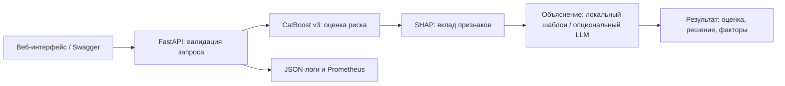

# Antifraud AI — обнаружение подозрительных банковских транзакций с XAI и LLM

**Учебный командный ML/MLOps-проект · вебинары 1–16 · Python · CatBoost · SHAP · FastAPI · GroqCloud**

В рамках проекта нами разработан прототип интеллектуальной системы анализа банковских транзакций. Сервис принимает параметры операции, рассчитывает оценку риска с помощью обученной модели машинного обучения, показывает влияющие на результат факторы и формирует объяснение для аналитика. Для демонстрации создан веб-интерфейс с интерактивной формой, примерами операций, визуализацией SHAP и доступом к техническому API.

> **Область применения:** образовательная демонстрация полного цикла разработки ML-сервиса. Обучающие данные синтетические, оценка риска не откалибрована как банковская вероятность мошенничества; система не подключена к реальным платёжным операциям и не блокирует их автоматически.

## 1. Цель, задача и результат

**Проблема.** Большой поток операций затрудняет своевременное выявление подозрительной активности. Помимо оценки риска, специалисту необходимо понимать, какие признаки повлияли на вывод алгоритма.

**Цель проекта** — спроектировать и реализовать объяснимый ML-сервис, способный оценивать транзакции и помогать оператору принимать решение о необходимости дополнительной проверки.

**Результаты разработки:**

- Подготовлен и исследован учебный датасет v3; выполнены проверки качества и анализ ограничений.
- Проведено сравнение RandomForest, CatBoost, LightGBM и ансамбля CatBoost + LightGBM.
- Обучена и сохранена модель **CatBoost v3** для демонстрационного API; артефакт модели включён в репозиторий.
- Реализован скоринг через **FastAPI**, включая валидацию входных признаков и структурированный ответ.
- Интегрированы **CatBoost SHAP** и русскоязычное объяснение значимых факторов.
- Добавлен опциональный **LLM-слой** с поддержкой GroqCloud, Grok и OpenRouter и безопасным локальным резервным объяснением.
- Создан адаптивный веб-интерфейс с формой, примерами сценариев, результатом оценки, SHAP-графиками и разделом метрик.
- Подготовлены тесты, GitHub Actions CI, Docker-конфигурация, Prometheus-метрики, JSON-логи, документация развёртывания и стратегия мониторинга.

## 2. Архитектура решения



| Компонент | Назначение | Реализация |
|---|---|---|
| Данные и исследование | Подготовка признаков, проверка качества, сравнение моделей | Python, pandas, scikit-learn, CatBoost, LightGBM |
| ML-ядро | Скоринг операции по 13 признакам | Сохранённый CatBoost v3 |
| Объяснимость | Выявление факторов, повышающих и снижающих оценку риска | Нативные SHAP-значения CatBoost |
| LLM-слой | Дополнительный выбор подтверждённых SHAP-факторов для объяснения | GroqCloud / Grok / OpenRouter, опционально |
| API | Приём транзакции, валидация, скоринг, ответы | FastAPI, Pydantic |
| Пользовательский интерфейс | Ввод транзакции и визуализация ответа | HTML, CSS, JavaScript |
| Контроль качества и эксплуатация | Тесты, CI, логи, метрики, контейнеризация | pytest, GitHub Actions, Prometheus, Docker |

**Принцип объяснимости:** LLM не определяет факт мошенничества, не меняет оценку модели и не придумывает новые причины. Источником факторов служит SHAP. При недоступности LLM используется детерминированное объяснение. Значения SHAP представлены во вкладах в *log-odds*, а не в процентных пунктах вероятности.

## 3. Данные и модель

Для исследования использован синтетический датасет **v3 из 7 000 размеченных транзакций**, относящихся к 220 пользователям. В нём 321 операция с положительной меткой (4,59%). Дополнительная история из 3 776 событий использовалась для расчёта признаков и не включалась в размеченные 7 000 операций.

| Выборка | Число операций | Назначение |
|---|---:|---|
| Train | 5 000 | Обучение |
| Validation | 1 000 | Сравнение моделей и выбор порога |
| Test | 1 000 | Независимая итоговая оценка |
| **Всего** | **7 000** | Хронологическое разбиение |

Модель использует 13 признаков, включая сумму, час и день операции, среднюю сумму за 30 дней, частоту операций, разнообразие мерчантов и стран, возраст устройства, признаки нового устройства и ночной операции, канал и страну. Идентификаторы, метка `is_fraud` и столбец `split` не используются как предикторы.

### Результаты сравнительного эксперимента v3

| Алгоритм | PR-AUC, validation | PR-AUC, test |
|---|---:|---:|
| RandomForest | 0.25328 | 0.22334 |
| CatBoost | 0.24352 | 0.21451 |
| LightGBM | 0.20174 | **0.25524** |
| CatBoost + LightGBM (blend) | **0.25779** | 0.22161 |

**Интерпретация:** ансамбль показал лучший PR-AUC на валидации, а LightGBM — на тесте. CatBoost выбран как реализованный кандидат для API и демонстрации SHAP, **не как доказанно лучший алгоритм**. Порог направления на ручную проверку выбирался на validation, а не на test.

В анализе данных выявлена сильная связь признака нового устройства с синтетической меткой мошенничества; это ограничение генератора и риск переноса модели на реальные данные. Обобщение на новых клиентов и реальные банковские операции не подтверждено.

Подробности: [сравнение моделей](docs/V3_BENCHMARK.md), [эксперименты](docs/05_experiments_mlflow.md), [тестирование](docs/07_model_testing.md).

## 4. Пользовательский сценарий и интерфейс

Веб-интерфейс позволяет описать операцию: указать сумму, канал, страну, средний чек, количество операций за 24 часа и 7 дней, число уникальных мерчантов и стран, возраст устройства и время транзакции. Признаки нового устройства и ночной операции рассчитываются автоматически.

После нажатия **«Проверить транзакцию»** браузер вызывает `POST /v1/score`. На экране отображаются:

1. Оценка риска модели и решение **«Одобрить» / «На ручную проверку»**.
2. Пять наиболее значимых SHAP-факторов с направлением и величиной вклада.
3. Текстовое объяснение и указание фактически использованного метода: локальный SHAP-шаблон либо подтверждённый ответ GroqCloud.
4. Версия модели и сведения об учебном характере данных.

В интерфейсе предусмотрены три примера — обычная, подозрительная и ночная операция. Они **заполняют форму**, но не подменяют результат заранее заданным ответом. Дополнительно доступны разделы «О модели», «Метрики и результаты», «Примеры кейсов» и «API (Swagger)».

**Важное ограничение:** выводимая оценка — некалиброванный скор модели. Даже высокий риск означает рекомендацию ручной проверки, а не доказанное мошенничество и не автоматическую блокировку.

## 5. Реализация практик вебинаров 1–16

Ниже приведён результат работы по каждому занятию и соответствующие материалы проекта. Наличие скрипта или проектного решения отдельно от его фактического запуска отмечено явно.

| Вебинар | Тема и выполненная работа | Материалы |
|---|---|---|
| **01** | **Жизненный цикл AI-продукта.** Определены бизнес-проблема, заинтересованные стороны, этапы ML-разработки, метрики и основные риски. | [01_lifecycle.md](docs/01_lifecycle.md) |
| **02** | **Архитектура.** Спроектирован путь транзакции от входного интерфейса через API и ML-модель к объяснению и мониторингу; описаны компоненты и связи. | [02_architecture.md](docs/02_architecture.md) |
| **03** | **Контракт ML-сервиса.** Определены входные поля, правила валидации, выходной формат, ошибки и ограничения API. | [03_contract.md](docs/03_contract.md) |
| **04** | **MLOps-зрелость.** Проведена оценка процессов и подготовлена дорожная карта развития: воспроизводимость, CI/CD, мониторинг и управление моделями. | [04_mlops_profile.md](docs/04_mlops_profile.md) |
| **05** | **MLflow и эксперименты.** Подготовлен сценарий трекинга экспериментов v3 и сравнения запусков; выполнение полного MLflow-прогона в целевой среде не подтверждено. | [05_experiments_mlflow.md](docs/05_experiments_mlflow.md), [webinar05_mlflow_v3.py](experiments/webinar05_mlflow_v3.py) |
| **06** | **Качество данных.** Исследован отдельный исходный проблемный датасет, зафиксированы нарушения согласованности истории; реализован валидатор на pandas. Great Expectations не запускался. | [06_data_validation.md](docs/06_data_validation.md), [webinar06_validate_legacy.py](experiments/webinar06_validate_legacy.py) |
| **07** | **Тестирование ML.** Разработаны проверки схемы, качества и особенностей v3. Локальное выполнение тестов с предоставленным CSV подтверждалось; в CI зависящие от отсутствующего CSV тесты пропускаются. | [07_model_testing.md](docs/07_model_testing.md), [test_webinar07_quality.py](tests/test_webinar07_quality.py) |
| **08** | **Стратегия тестирования.** Подготовлены unit-, integration- и mock-тесты для компонентов сервиса и негативных сценариев. | [08_testing_strategy.md](docs/08_testing_strategy.md), [test_webinar08_components.py](tests/test_webinar08_components.py) |
| **09** | **API для ML.** Реализован FastAPI со скорингом, сведениями о модели, healthcheck и Swagger; добавлен веб-интерфейс. Сквозная браузерная проверка последнего интерфейса ещё не подтверждена. | [09_api_for_ML.md](docs/09_api_for_ML.md), [app.py](src/antifraud/app.py) |
| **10** | **Стратегия развёртывания.** Спроектированы варианты выпуска, shadow/canary, контроль метрик и rollback. Промышленное canary-развёртывание не проводилось. | [10_deploy_strategy.md](docs/10_deploy_strategy.md) |
| **11** | **Контейнеризация и деплой.** Подготовлены Dockerfile, Docker Compose и конфигурация GitHub Codespaces с автозапуском учебной модели. | [11, 12_deploy_and_support.md](docs/11%2C%2012_deploy_and_support.md), [Dockerfile](Dockerfile), [devcontainer.json](.devcontainer/devcontainer.json) |
| **12** | **Наблюдаемость.** Реализованы структурированные JSON-логи и endpoint `/metrics` для Prometheus; определены эксплуатационные метрики и сигналы. Полноценная внешняя система алертинга не развёрнута. | [11, 12_deploy_and_support.md](docs/11%2C%2012_deploy_and_support.md), [observability.py](src/antifraud/observability.py) |
| **13** | **Data drift.** Выполнены расчёты KS/PSI на train и validation v3, выявлен выраженный сдвиг `device_age_days`; описаны пороги, реакция и стратегия переобучения. Онлайн-мониторинг дрейфа не запущен. | [13_drift_strategy.md](docs/13_drift_strategy.md), [webinar13_drift_v3.py](experiments/webinar13_drift_v3.py) |
| **14** | **Проектирование AI-агента.** Описан ассистент аналитика антифрода: цель, четыре инструмента, источники, метрики, риски и схема ReAct с двумя итерациями. По заданию разработан проект агента, не исполняемый агент. | [14_AI_agent.md](docs/14_AI_agent.md) |
| **15** | **Промпт-инжиниринг.** Разобран процесс уточнения задачи с AI-ассистентом, реализован поиск пар чисел и pytest-тесты; формулировки промптов восстановлены, не представлены как дословный журнал переписки. | [15_prompt_engineering.md](docs/15_prompt_engineering.md), [webinar15_pairs.py](experiments/webinar15_pairs.py) |
| **16** | **Ответственный AI и code review.** Проведён аудит безопасности, обработки PII, секретов, галлюцинаций LLM, смещений и ограничений эксплуатации; сформулированы критерии приёмки. Отзыв ранее раскрытого ngrok-токена владельцем ещё не подтверждён. | [16_vibe_coding.md](docs/16_vibe_coding.md) |

Общий реестр выполнения: [PRACTICE_COVERAGE.md](docs/PRACTICE_COVERAGE.md). Итоговый аудит: [FINAL_AUDIT_01_16.md](docs/FINAL_AUDIT_01_16.md). Формальная сдача отдельных материалов преподавателю в сторонних системах не подтверждена и не приравнивается к наличию файлов в репозитории.

## 6. Проверки, безопасность и ограничения

**Реализованные меры:** проверка Pydantic-схемы и согласованности вычисленных признаков, ограничение внешних LLM-провайдеров известными адресами, передача только обезличенных SHAP-факторов, отказ от автоматической блокировки, детерминированный fallback объяснения, тесты, CI, логи и метрики.

**Ограничения текущего прототипа:**

- Синтетические данные не подтверждают качество на реальном банковском потоке; вероятность модели не калибрована.
- Полный E2E последнего веб-интерфейса, включая живой ответ GroqCloud, требует отдельной проверки в запущенном Codespaces.
- MLflow v3, Great Expectations, внешние алерты и промышленное развёртывание не заявляются как завершённые.
- Модель CatBoost используется в API как технический кандидат; окончательный выбор champion-модели требует дополнительного обоснования.
- Ранее раскрытый ngrok-токен должен быть отозван владельцем; наличие обновлённого кода не устраняет секрет из истории Git.

## 7. Структура репозитория

```text
Fraud_Detection_with-XAI_and_LLM/
├── .devcontainer/                  # Настройки Codespaces
├── catboost-v3-artifact.zip        # Обученная учебная модель v3
├── src/antifraud/
│   ├── app.py                      # FastAPI и маршруты
│   ├── dashboard.html              # Веб-интерфейс
│   ├── model_artifact.py           # Загрузка и проверка CatBoost
│   ├── explain.py                  # SHAP-объяснение
│   ├── llm.py                      # Опциональный LLM-слой
│   └── observability.py            # Логи и метрики
├── experiments/                    # Обучение, сравнение, аудит, практики
├── tests/                          # Автоматические проверки
├── scripts/
│   ├── start_codespaces.py         # Подготовка модели и запуск API
│   └── autostart_codespaces.sh     # Автозапуск среды
├── docs/                           # Практики вебинаров 1–16 и аудит
├── Dockerfile
├── docker-compose.yml
├── requirements.txt
└── README.md
```

Полный исходный датасет v3 не включён в репозиторий; в нём опубликован только обученный учебный артефакт модели и необходимый код. Секреты и реальные банковские данные в Git не добавляются.

---

## 8. Запуск и демонстрация

### GitHub Codespaces — основной способ показа

1. Открыть репозиторий в GitHub и выбрать **Code → Codespaces → Create codespace on main**.
2. Дождаться установки зависимостей и автоматического запуска приложения. Настройки среды находятся в `.devcontainer/devcontainer.json`.
3. Открыть вкладку **Ports**, порт **8000**, затем **Open in Browser**.
4. По корневому адресу `/` откроется **веб-интерфейс Antifraud AI**. Для технической проверки доступен Swagger по `/docs`.
5. Выбрать один из трёх примеров или ввести собственные параметры, нажать **«Проверить транзакцию»** и изучить оценку CatBoost, SHAP и текст объяснения.

Архив `catboost-v3-artifact.zip` уже находится в корне `main`. При запуске `scripts/start_codespaces.py` модель распаковывается в локальную папку среды, проверяется и загружается автоматически. **Каждому участнику не требуется отдельно скачивать или загружать модель.** Если артефакт недоступен, демонстрационный запуск прекращается, не подменяя CatBoost синтетической RandomForest.

Для ранее созданного Codespaces после обновления `main`:

```bash
git pull origin main
bash scripts/autostart_codespaces.sh
```

При необходимости запуск вручную:

```bash
python scripts/start_codespaces.py
```

Проверка API:

```text
/                  Веб-интерфейс
/docs              Swagger UI
/health            Состояние сервиса
/v1/model-info     Версия модели и признаки
/v1/score          POST: скоринг + SHAP + объяснение
/metrics           Метрики Prometheus
```

Ожидаемая версия в `/v1/model-info`: **`catboost-educational-v3`**, число признаков — **13**.

### Опциональная интеграция GroqCloud

Для внешнего LLM-объяснения необходимо сохранить `GROQ_API_KEY` в **GitHub Codespaces Secrets** с доступом к данному репозиторию и перезапустить среду. Стартовый скрипт автоматически задаёт провайдер `groq` и модель `openai/gpt-oss-120b`, если ключ доступен. Ключи не должны находиться в коде или README.

Факт успешного ответа GroqCloud определяется по полю `explanation_method=groq_grounded_selection`. Значение `shap_template` или `shap_template_fallback` означает, что использовано локальное объяснение, а не успешный внешний вызов.

### Тестирование

```bash
PYTHONPATH=src python -m pytest -q
```

Результаты автоматических проверок публикуются в [GitHub Actions](https://github.com/SamDerden/Fraud_Detection_with-XAI_and_LLM/actions). Успешный CI не заменяет проверку пользовательского сценария в браузере.

---

**Итог:** разработан и документирован образовательный прототип антифрод-системы, объединяющий ML-скоринг, объяснимость, API, веб-интерфейс и элементы MLOps. Результат демонстрирует архитектуру и инженерные подходы к созданию объяснимых ML-сервисов, сохраняя прозрачность ограничений и статуса фактической проверки.
