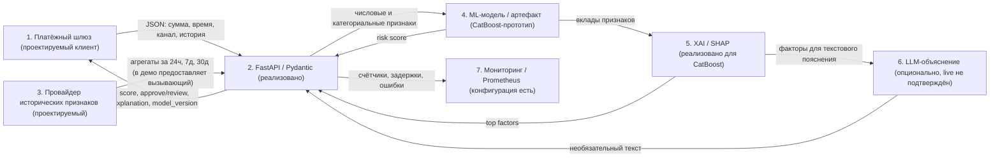

# Вебинар 2 — архитектурная схема антифрод-сервиса

**Кейс:** антифрод мобильного банка. Схема — логическая, описывает как реализованные части, так и внешние компоненты, необходимые для реального банка. Внешние компоненты отмечены как **проектируемые**, а не существующие.

## Схема: 7 блоков

**Пояснение к границам:** отдельного feature store и реального платёжного шлюза в репозитории нет. Для демонстрации исторические агрегаты передаются клиентом API. FastAPI, модель и XAI в текущем коде работают в одном Python-процессе, а не как независимые сетевые микросервисы. В `docker-compose.yml` отдельным сервисом является Prometheus. Схема показывает логические функции, а не заявляет семь запущенных контейнеров.

## Выбор stream или batch
**Stream (синхронный ответ на событие):** платёжный запрос требует оценки риска до завершения пользовательского сценария; пакетная обработка раз в сутки не подходит для оперативной реакции. **Batch** уместен для ночного пересчёта признаков, мониторинга, обучения и офлайн-оценки. В учебном проекте реализован HTTP request/response; полноценная потоковая платформа (Kafka и т. п.) не развёрнута.

## Три узких места и влияние на пользователя
1. **Провайдер признаков:** недоступная или устаревшая история → некорректная оценка либо отказ в обработке. В текущем учебном API нет автоматического получения истории, поэтому надёжность входа — ответственность вызывающей системы.
2. **ML-модель / артефакт:** отсутствующий или несовместимый файл → запрос может завершиться ошибкой; в реальном банке нужен отдельный безопасный fallback и ручная проверка, не автоматическое разрешение.
3. **LLM-провайдер:** высокая задержка или отказ → текстовое объяснение может быть недоступно; решение по риску не должно зависеть от ответа LLM. Сервис предусматривает опциональное объяснение, но SLA не подтверждён.

## Допущение
**Не моделируем авторизацию и банковскую платёжную инфраструктуру:** в учебном API отсутствуют реальные платежи, KYC и санкционирование операций.

## Самопроверка по В02
- [x] 7 подписанных блоков и направленные стрелки
- [x] Подписи потоков данных и результата
- [x] Письменный выбор stream/batch
- [x] Три узких места с последствиями
- [x] Одно допущение
- [ ] Ссылка/скриншот области команды в Holst и фактическая сдача преподавателю (в GitHub не подтверждены)

[Историческая схема из предыдущей версии](https://github.com/user-attachments/assets/30be9f06-bdc6-4415-b1b0-093f08e5670f) оставлена как справочный материал; актуальной является схема выше.
