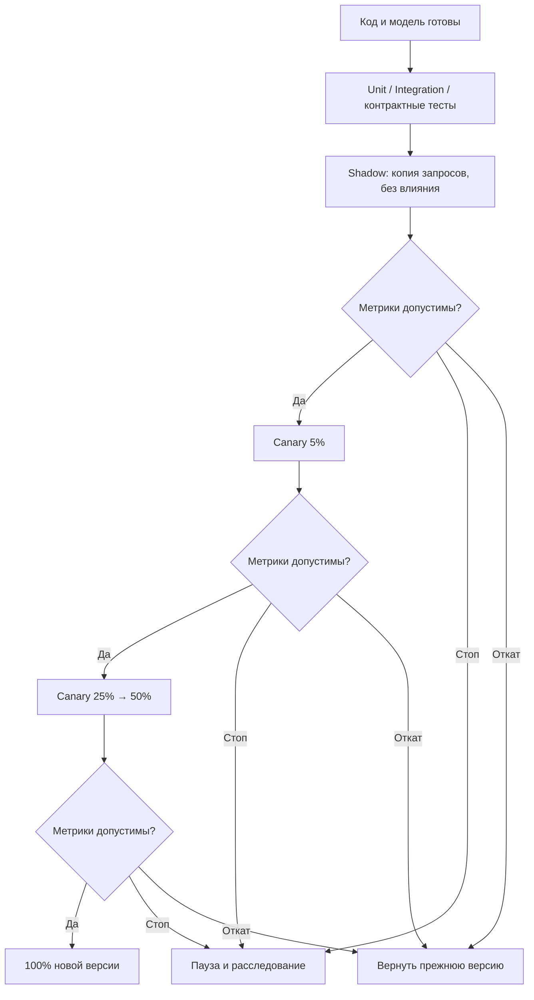

# Вебинар 10 — стратегия деплоя антифрод-сервиса

**Сервис:** учебный FastAPI антифрод с XAI. **Стратегия:** shadow → canary (5% → 25% → 50% → 100%). Это **проектирование на бумаге** по методичке В10, не утверждение о реальном релизе.

## 1. Выбор и обоснование
Ошибки модели могут быть «тихими»: снижение recall означает пропуск фрода, повышение FPR — ненужную ручную проверку легитимных операций. Shadow позволяет сравнить ответы новой и прежней версии без влияния на клиента. Canary ограничивает воздействие дефекта на часть трафика. Blue-green ускоряет откат, но полное переключение не даёт такого постепенного контроля.

## 2. Критерии успеха
| Метрика | Условие на сопоставимом окне |
|---|---|
| Recall по подтверждённым меткам | Не ниже старой версии более чем на 5% относительно |
| FPR по подтверждённым меткам | Не выше старой версии более чем на 5% относительно |
| HTTP 5xx error rate | Не выше 1% за 10 минут |
| p95 latency `/v1/score` | Не выше 500 мс за 10 минут |

**Важно:** fraud labels приходят с задержкой. Recall и FPR нельзя надёжно вычислить за 10 минут по обычным HTTP-логам; для них используется отложенная когорта с подтверждёнными метками. Указанные пороги — учебные проектные гипотезы, а не измеренные банковские SLA.

## 3. Пороги остановки и отката
| Условие | Окно | Действие |
|---|---|---|
| FPR по зрелой размеченной когорте выше baseline на 10% относительно | после поступления меток, контроль ежедневно | Остановить увеличение доли |
| Recall по зрелой когорте ниже baseline на 15% относительно | после поступления меток, контроль ежедневно | Откатить |
| HTTP 5xx > 1% | 10 минут | Остановить rollout, расследовать |
| HTTP 5xx > 5% | 10 минут | Откатить |
| p95 > 500 мс | 10 минут | Остановить rollout |
| p95 > 1000 мс | 5 минут | Откатить |

Автоматический откат **не реализован** в учебном коде; в проектируемой системе пороги дают сигнал дежурному.

## 4. План отката
**Ответственный:** дежурный MLOps-инженер; для влияния на банковские операции — согласование с владельцем антифрода. **Цель реакции:** до 15 минут после подтверждённого сигнала. **Механика:** вернуть прежнюю модель/контейнер и маршрутизацию, сохранить идентификатор версии в журнале. **Уже обработанные запросы:** решения не отменяются автоматически; пометить для анализа, передать сомнительные операции на ручную проверку. Автоматической блокировки платежей в учебном сервисе нет.

## 5. Схема процесса

**Для сдачи:** документ стратегии готов. Методичка требует Google Docs и Holst либо текстовую схему в документе; ссылка на фактическую сдачу не подтверждена.
