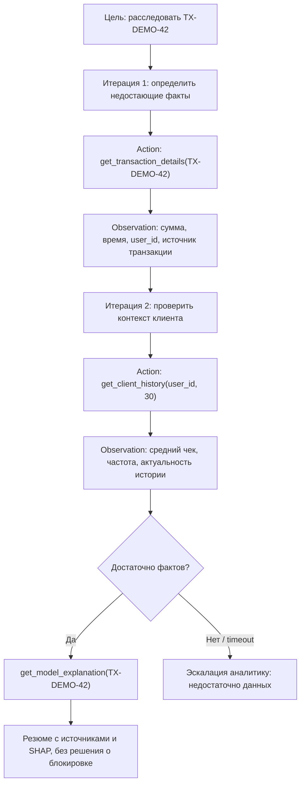

# Вебинар 14 — проектирование ИИ-агента (практика)

**Источник:** «В14_Практика_студентам.md». Задание требует **проект**, не код: цель, минимум три инструмента, источники, типы запросов, измеримые метрики, минимум три риска и схема ReAct с двумя итерациями. Используем разрешённый методичкой кейс итогового проекта.

## Задача и цель
**Название:** ассистент аналитика антифрода. **Цель:** по идентификатору синтетической транзакции собрать проверяемые факты и объяснение ML-скоринга, сформировать краткое резюме для **ручного** решения аналитика. Агент не может блокировать, одобрять или изменять транзакции.

## Компоненты
- **Goal:** подготовить расследовательское резюме с источниками.
- **Tools:** `get_transaction_details(transaction_id)` — запись транзакции; `get_client_history(user_id, days)` — агрегаты и история; `get_model_explanation(transaction_id)` — скоринг и SHAP; `search_similar_cases(transaction_id)` — похожие **подтверждённые** случаи.
- **Memory:** только контекст текущего расследования, идентификаторы вызовов и результаты; без хранения PII в промпте.
- **Planning:** сначала детали транзакции, затем история, затем XAI и сходные случаи при наличии данных; максимум четыре инструментальных вызова и две итерации принятия решения.
- **Источники:** проектируемая транзакционная БД, проектируемая БД подтверждённых случаев, текущий ML API. **Банковские БД и инструменты агента не реализованы в репозитории.**
- **Запросы:** «почему высокий риск?», «что известно о поведении клиента?», «какие подтверждённые похожие случаи?».

## Метрики успеха (проектные цели, не измеренные факты)
| Метрика | Расчёт | Цель |
|---|---|---|
| Проверяемость | Резюме с указанием ID фактических источников / все резюме | >=95% |
| Фактическая точность | Проверенные утверждения / все утверждения в контрольной выборке | >=99% |
| Эскалация | Случаи с недоступным источником, корректно переданные человеку / все такие случаи | 100% |
| Время | Медиана подготовки резюме на синтетических кейсах | <=60 секунд |

## Риски и меры
1. **Галлюцинация факта/правила:** LLM может придумать банковское правило. Мера: только структурированные результаты инструментов, ID источника, при отсутствии данных «не подтверждено».
2. **Неверный инструмент/зацикливание:** неоднозначный план приводит к повторным запросам. Мера: лимит вызовов, timeout, явный маршрут эскалации.
3. **Устаревшие данные:** поздние fraud labels и кэш могут исказить вывод. Мера: `as_of` и `updated_at` в результатах, запрет категоричных выводов при просрочке.
4. **Утечка данных:** LLM может получить PII. Мера: минимизация полей, синтетические данные, аудит доступов.

## Схема ReAct — две полные итерации

**Учебный пример (вымышленные результаты, не реальные вызовы):** TX-DEMO-42, сумма 50 000 RUB; история показывает средний чек 3 500 RUB. Агент отмечает отношение 14.3 и запрашивает объяснение модели. Если объяснение отсутствует, агент прямо сообщает об этом и не придумывает причины.

## Проверка методички
- [x] Цель и 4 конкретных инструмента
- [x] Источники и типы запросов
- [x] 4 измеримые метрики, 4 предметных риска
- [x] ReAct с двумя итерациями, Action и Observation
- [ ] Ссылка на Holst/Google Docs и отправка преподавателю (не подтверждены)

**Не требуется:** писать или запускать реального агента. Никакой агент не развёрнут.
